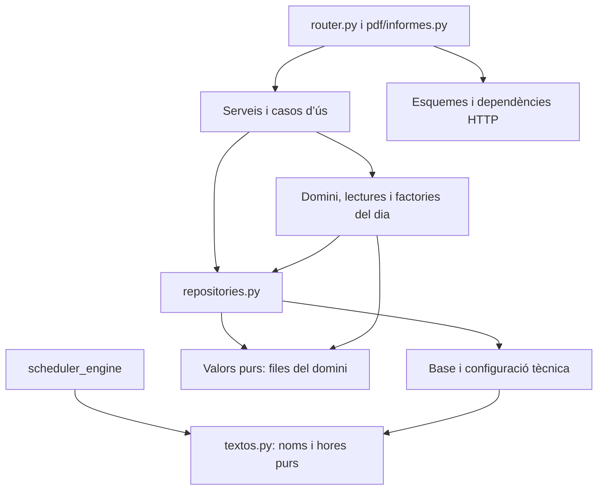

# Arquitectura

Què és cada fila de substitució i què compta cada pantalla, PDF i informe:
[`FUNCIONAMENT.md`](FUNCIONAMENT.md).

## Mapa de dependències

### Capes del backend i peces compartides

El graf de dependències és acíclic, comptant també els imports interiors i els
motors del registre dinàmic de `scheduler_engine/factory.py`. Ho comprova el guardià AST
`tests/test_dependencies_capes.py`, juntament amb les regles següents:



- Base: `database`, `models`, `noms`, `parametres`, `rellotge`, errors,
  `i18n_setup` i `config/`; també `dates`, `ordre_curs`, `nivells` i `textos`,
  que només transformen valors. La validació d’esquemes de `database` és
  infraestructura de `schema_migrations/`, sense dependències del domini.
- Repositoris: base, altres repositoris i valors purs de `*/files.py`
  (dataclasses sense I/O). Cap horari, servei, ruta ni context de petició,
  tampoc a través de les vistes de `config.constants`. La puresa dels mòduls
  de files també té guardià.
- Domini i serveis: sense rutes. El domini no importa `services.py`; els
  serveis orquestren el domini i els repositoris. Els noms `generacio`,
  `disponibles`, `importacio`, `cost` i `publicacio` també són casos d’ús.
- Routers: HTTP, serveis, tipus i dependències. Les preferències i el recompte
  de vigilàncies sense nivell del PDF passen per `pdf/services.py`.
- Motor: sense FastAPI, Pydantic, SQLAlchemy, BD ni context de petició. L’única
  peça compartida amb l’aplicació és `textos.py`, de biblioteca estàndard.
  L’informe de professors rep explícitament la funció d’abreviatures des de
  `planificador/generacio.py`; la lògica de cerca i de cost es conserva.

Peces compartides, cadascuna en un únic lloc:

| Peça | Ubicació | Consumidors |
|---|---|---|
| Nivell derivat del codi de grup | `nivells.py` | Propostes i ordre de cursos |
| Escapat de text ReportLab | `pdf/text.py` | Motor PDF i taules |
| Lectura i vista d’absències cobertes | `absencia_coberta/domain.py` | Horari i serveis |
| Alliberats efectius per dia i interval | `grups/lectures.py` | DiaEscolar, vigilàncies, PDF i recomptes |
| Neteja de substituts invàlids | `substitucions/reconciliacio.py` | Serveis d’absències i alliberaments |
| Noms i hores normalitzats | `textos.py` | Lectors XML, API i motor |

Hi ha vuit imports interiors de producció: tres al PDF (partició
opcional amb `pyphen` i Pillow quan hi ha logo, al PDF combinat i
a l’informe de direcció) i cinc al CLI
d’esborrat (després de validar arguments). Cada línia porta `noqa: PLC0415`
amb el motiu, que el guardià exigeix exactament. Als tests es permeten imports
locals per fixtures, monkeypatch i recàrregues amb entorn aïllat.

```
┌──────────────────────────────────────────────────────────────────┐
│                        FRONTEND (Vue 3)                          │
│                                                                  │
│  main.js → App.vue (i18n, PrimeVue) — navegació per tabs  │
│  adreca.js ← adreça per pantalla i diàleg (sense vue-router)     │
│                                                                  │
│  VISTES PRINCIPALS                                               │
│  ├── SubstitucionsView.vue                                       │
│  ├── VigilanciesView.vue                                         │
│  ├── GrupsView.vue                                               │
│  └── SchedulerView.vue                                           │
│        ├── SchedulerView.css                                     │
│        ├── useSchedulerApi.js           ← crides API             │
│        ├── useSchedulerResults.js       ← processa resultats     │
│        ├── useSchedulerIncidencies.js                            │
│        ├── useSchedulerRestrictions.js                           │
│        ├── useSchedulerSlotsConfig.js                            │
│        ├── useAlliberamentsPerNivell.js                          │
│        ├── analysisParsers.js                                    │
│        ├── dateUtils.js / idUtils.js / textUtils.js              │
│        ├── incidentFormatters.js                                 │
│        └── steps/: SchedulerDialogs, StepConfig, StepGroups,     │
│                    StepRestrictions, StepAnalysis, StepResults   │
│                                                                  │
│  COMPONENTS                                                      │
│  ├── ConfiguracioDialog.vue                                      │
│  ├── ConfiguracioExamensDialog.vue                               │
│  ├── EstadistiquesDialog.vue                                     │
│  ├── PublicarVigilanciesDialog.vue                               │
│  ├── ProfileDialog.vue                                           │
│  ├── AjudaDialog.vue                                             │
│  ├── ConflicteDialog.vue                                         │
│  ├── HorariEditable.vue                                          │
│  ├── SlotDropZone.vue                                            │
│  └── config/: pestanyes de Configuració (Absències cobertes,     │
│               Prioritats, Grups, Cursos, Usuaris, Gestió de      │
│               dades...)                                          │
│                                                                  │
│  substitutsTrets.js ← avís dels substituts trets per un canvi    │
│  dataTreball.js ← data de treball (data del calendari), store    │
│  dates.js       ← dataIso / dataAmbAny (mai toISOString)         │
│  locales/: ca.json, es.json, en.json, it.json                    │
│  i18n.js ← configuració vue-i18n                                 │
└────────────────────────┬─────────────────────────────────────────┘
                         │ HTTP (Vite proxy dev / Nginx prod)
                         ▼
┌──────────────────────────────────────────────────────────────────┐
│                    BACKEND (FastAPI)                             │
│                                                                  │
│  main.py  ← punt d'entrada, registra tots els routers            │
│                                                                  │
│  MÒDULS (estructura nova; vegeu «Estructura d'un mòdul»)         │
│  ├── auth/               → entrar, sortir, perfil propi, cookie  │
│  │                         JWT i Depends de l'usuari i del rol   │
│  ├── usuaris/            → gestió d'usuaris (admin i superadmin) │
│  ├── prioritats/         → categories i pesos, «No substituir» i │
│  │                         la càrrega a memòria                  │
│  ├── grups/              → grups sense classe i professors i     │
│  │                         activitats alliberats per dia i per   │
│  │                         període, activitats alliberables i    │
│  │                         grups amagats i abreviatures de grups │
│  ├── absencia_coberta/   → absències cobertes (abans «baixes»):  │
│  │                         l'horari del dia ja no té l'absent    │
│  ├── vigilancies/        → vigilàncies: assignació per hora,     │
│  │                         ordre desat, ajuda del vigilant i     │
│  │                         afinitats entre nivells               │
│  ├── substitucions/      → absències, substitucions, encadenades,│
│  │                         generació (assignacio.py), regles del │
│  │                         dia (domain.py) i cobertures          │
│  ├── pdf/                → PDF del dia, de vigilàncies, de       │
│  │                         disponibles i informes (/api/pdf/*,   │
│  │                         /api/informes/*); vegeu EXPORTACIÓ    │
│  ├── recomptes/          → els recomptes, en un sol lloc: els    │
│  │                         fan servir els informes i les         │
│  │                         Estadístiques (FUNCIONAMENT.md)       │
│  ├── estadistiques/      → pantalla Estadístiques                │
│  │                         (/api/estadistiques/*)                │
│  ├── configuracio/       → configuració del centre               │
│  │                         (/api/settings, idiomes) i el logo    │
│  ├── centres/            → centres (superadmin):                 │
│  │                         /api/settings/institucions            │
│  ├── horari/             → l'horari vigent (/api/horari/*,       │
│  │                         /api/config, /api/professors,         │
│  │                         /api/hores), pujada i versions de     │
│  │                         l'XML                                 │
│  ├── configuracio_examens/ → nivells, assignatures, grups,       │
│  │                         aules, titulars, importació i         │
│  │                         exportació (/api/config/*)            │
│  ├── cursos/             → cursos acadèmics                      │
│  ├── dades/              → governança de dades (RGPD): purga i   │
│  │                         reanomenar professors inactius        │
│  └── planificador/       → planificador d'exàmens                │
│                            (/api/scheduler/*, només admins)      │
│        ├── services.py      ← configuració, dates, restriccions, │
│        │                      fixats, costos, últim horari i     │
│        │                      avís de curs anterior              │
│        ├── config.py        ← ConfigPlanificador, durades        │
│        ├── planificacio.py  ← prepara_planificacio (generar i    │
│        │                      analitzar) i l'XML de la data      │
│        ├── generacio.py     ← generar i analitzar amb el motor   │
│        ├── diagnostic.py    ← per què no és viable               │
│        ├── cost.py          ← recàlcul del cost d'un horari      │
│        │                      editat                             │
│        ├── publicacio.py    ← publicar com a vigilàncies         │
│        ├── restriccions.py  ← llegir i desar les restriccions    │
│        ├── alliberaments.py ← hores marcades, dates i franges    │
│        ├── examens.py       ← «Assignatura (nivell)»             │
│        └── repositories.py  ← claus de configuració, restriccions│
│                               i costos                           │
│                                                                  │
│  CONTEXT DEL DIA                                                │
│  ├── horari/domain.py       ← Dia: data, centre i XML vigent     │
│  ├── horari/context.py      ← resolució i memòria cau d’horaris  │
│  └── substitucions/context.py ← gestors nous per petició         │
│                                                                  │
│  CAPA DE LÒGICA DE NEGOCI                                        │
│  ├── horari/lector.py                ← GestorHorariWeb (parser XML  │
│  │                                  FET + abreviatures BD;       │
│  │                                  memòria cau a horari/        │
│  │                                  context.py: get_horari())     │
│  ├── grups/disponibilitat.py           ← grups, professors i          │
│  │                                  activitats alliberats;       │
│  │                                  sense_classe (qui no té      │
│  │                                  classe a una hora)           │
│  ├── substitucions/necessitats.py            ← filtre absències reals       │
│  ├── vigilancies/context.py      ← lògica vigilàncies           │
│  └── vigilancies/prioritats.py                               │
│                                                                  │
│  SCHEDULER ENGINE (planificador exàmens)                         │
│  ├── factory.py                   ← selecciona motor             │
│  ├── defaults.py                  ← valors per defecte           │
│  ├── validacio.py                 ← genera logs d'incidències    │
│  ├── estadistiques.py             ← estadístiques del pla        │
│  ├── domain/models.py             ← models de domini             │
│  ├── generators/base.py           ← classe base motors           │
│  ├── generators/v2_intents.py                                    │
│  ├── generators/v2_backtrack.py                                  │
│  ├── generators/v3_sa.py          ← Simulated Annealing          │
│  └── core/: context, constraints, scoring, availability,         │
│             durada, date_mapping, diagnostic,                    │
│             normalitzacio, restriction_engine                    │
│                                                                  │
│  CAPA D'ACCÉS A DADES                                            │
│  ├── database.py          ← sessions SQLAlchemy (auth + dades)   │
│  ├── schema_migrations/   ← Alembic, base congelada i validació │
│  ├── */repositories.py    ← consultes pròpies de cada mòdul     │
│  ├── models.py            ← models SQLAlchemy (taules principals)│
│  └── schemas.py           ← models Pydantic (request/response)   │
│                                                                  │
│  EXPORTACIÓ PDF                                                  │
│  ├── export/pdf_styles.py         ← estils comuns                │
│  ├── export/pdf_images.py         ← imatges embegudes            │
│  └── pdf/ (mòdul)                 ← rutes, casos d'ús, dibuix    │
│        ├── router.py              ← rutes /api/pdf/*             │
│        ├── informes.py            ← rutes /api/informes/*        │
│        ├── generacio.py           ← dia, vigilàncies, interval   │
│        ├── disponibles.py         ← professors disponibles       │
│        ├── services.py            ← dades de cada informe (els   │
│        │                            recomptes, a recomptes/)     │
│        ├── repositories.py        ← preferències, consultes      │
│        ├── domain.py              ← opcions, resultat, errors    │
│        ├── validacions.py         ← conflictes i avisos          │
│        ├── engine.py              ← motor principal              │
│        ├── taula.py               ← model de la taula del dia    │
│        ├── informe_direccio.py    ← dibuix informe direcció      │
│        └── informe_professors.py  ← dibuix informe professor     │
│                                                                  │
│  INFRAESTRUCTURA                                                 │
│  ├── config/settings.py   ← Config global (institucions)         │
│  ├── config/auth.py       ← JWT, usuaris per defecte             │
│  ├── config/constants.py  ← PRIORITATS, NO_SUBST, baixes: vistes │
│  │                           de les dades de cada centre         │
│  ├── config/pdf.json      ← perfils visuals PDF                  │
│  ├── dependencies.py      ← Depends FastAPI: get_db (la BD de la │
│  │                           institució de l'usuari) i el Dia    │
│  │                           (calendari / planificació / avui)   │
│  ├── i18n_setup.py        ← traduccions backend (PDF)            │
│  ├── rate_limit.py        ← limitació de peticions               │
│  ├── errors_servidor.py   ← errors no previstos: es registren    │
│  │                           amb una referència; l'usuari només  │
│  │                           rep la referència                   │
│  ├── noms.py              ← NomNet i ordre alfabètic             │
│  ├── parametres.py        ← DataISO, HoresTriades: paràmetres    │
│  │                           comuns de les rutes                 │
│  ├── errors_domini.py     ← errors de les regles (NoTrobat,      │
│  │                           NoPermes, NoValid, Conflicte)       │
│  ├── dates.py             ← lectura i format de dates           │
│  ├── textos.py      ← noms i franges purs                        │
│  ├── grups/abreviatures.py ← abreviatures dels grups             │
└──────────────────────────────────────────────────────────────────┘
                         │
               ┌─────────┴─────────┐
               ▼                   ▼
     SQLite: auth.db        SQLite: gestor.db
     (usuaris globals)      (una per institució)
               │                   │
               └─────────┬─────────┘
                         │
                    ./data/
                    ├── auth.db
                    ├── config.json (o APP_CONFIG_PATH)
                    └── {institucio}/
                        ├── gestor.db
                        ├── *.xml  (horari FET)
                        └── exports/
```

## Files del domini

Les lectures de substitucions i vigilàncies retornen objectes amb atributs,
sense `.get()`, `__getitem__` ni interfície de diccionari. Les dates i les
hores són text. Les instantànies de BD són immutables i no estan
vinculades a l’ORM: els canvis passen pels repositoris i es rellegeixen. Les
operacions d’escriptura conserven els models ORM i les transaccions existents.

| Objecte | Mòdul | Camps | Ús i mutabilitat |
|---|---|---|---|
| `FilaSubstitucio` | `substitucions/files.py` | `id`, `data`, `hora`, `professor_absent`, `assignatura`, `grup`, `aula`, `substitut`, `tipus_substitut`, `tipus_absencia`, `comentaris`, `updated_at`, `created_at` | Instantània immutable del dia o dels recomptes. |
| `PropostaSubstitucio` | `substitucions/files.py` | `professor_absent`, `hora`, `assignatura`, `grup`, `aula`, `substitut`, `tipus_substitut`, `tipus_absencia`, `comentaris`, `professor`, `separador`, `disponibles`, `conservat` | Mutable: el motor hi assigna substituts i candidats abans de desar. |
| `FilaVigilancia` | `vigilancies/files.py` | `id`, `hora`, `tipus`, `grups`, `aula`, `vigilant`, `comentaris`, `nivell`, `ordre`, `updated_at`, `data` | Instantània immutable del dia o dels recomptes. |
| `SubstitucioPdf` | `pdf/files.py` | Els de `FilaSubstitucio`, més `dia_interval` i `data_iso`. | Còpia immutable amb el dia de l’interval. |
| `VigilanciaPdf` | `pdf/files.py` | Els de `FilaVigilancia`, més `dia_interval`, `data_iso` i `dia_buit`. | Còpia immutable; també representa un dia buit de l’interval. |

Cada camp té tipus i valor per defecte explícits. La lectura diària conserva
els buits normalitzats; els identificadors diaris són de text. Les
substitucions dels recomptes conserven l’identificador enter, els `NULL` i els timestamps SQL
històrics. La projecció de vigilàncies dels recomptes conserva el vigilant
`NULL` i la data ISO. 
`SubstitucioRepository.get_by_date` retorna `list[FilaSubstitucio]` i
`VigilanciaRepository.get_by_date`, `dict[str, list[FilaVigilancia]]`. Els
recomptes també retornen les files tipades.

La conversió HTTP de substitucions és a `substitucions/schemas.py`:
`resposta_substitucio` per al llistat i `FilaDesadaResponse` amb atributs per
als conflictes 409. `resposta_vigilancia` construeix `VigilanciaDelDia`. Els
esquemes conserven els camps exposats i exclouen les metadades internes.
Vigilàncies desa un únic identificador (`FilaVigilancia.id`, ID de BD en text).
El llistat HTTP exposa `id` en text i `db_id` enter, derivats del mateix ID
a `resposta_vigilancia`. El domini el guarda com a text perquè també
determina els empats del motor.
El frontend consumeix `id` per editar, esborrar, ordenar, seleccionar i demanar disponibles; no
consumeix `db_id` ni genera IDs compostos. El planificador compara directament l’ID únic.

El PDF llegeix atributs; omplir una aula crea una còpia amb `replace`, i les
metadades d’interval es construeixen només a la capa de presentació.

El guardià `tests/test_files_sense_diccionaris.py` comprova els contractes dels
repositoris, els accessos per clau (també àlies i vigilàncies agrupades), les
interfícies i la puresa de `files.py`. Inclou proves negatives sobre
consumidors reals. Els diccionaris de petició, activitats XML, configuració i
resultats agregats són estructures diferents i conserven el seu contracte.

## Esquemes i configuració persistent

`database.py` delega la inicialització a `schema_migrations/runner.py`.
La base `0001_base` conté SQL congelat per a auth i dades, separat dels models
vius. Abans d’estampar una BD existent es compara tot l’esquema amb la base,
amb les variants conegudes dels antics ALTER i la taula històrica opcional
`exam_schedules` comprovada exactament. El stamp només afegeix metadades de
versió; no modifica files. Una BD nova crea la base, s’estampa i aplica les
revisions següents. Una BD existent amb revisions pendents es rebutja fins
que l’operador executa `python -m scripts.migra_esquemes` amb el servei aturat.
L’script rep camins explícits, valida tota la llista en només lectura i exigeix
una carpeta de còpies per aplicar; cada BD es migra en una transacció SQLite
explícita. Les inicialitzacions concurrents se serialitzen dins del procés i
amb el bloqueig de SQLite entre processos.

La configuració global mutable va a `APP_CONFIG_PATH` o, per defecte,
`DATA_DIR/config.json`. El fitxer antic `backend/config/config.json` només
es llegeix si encara falta el nou; qualsevol desat va al camí nou. Les
configuracions de cada centre continuen a la seva BD i el perfil PDF
versionat és un recurs estàtic de només lectura. El contenidor executa el
backend amb UID/GID `10001:10001`; els volums de dades han de tenir permisos
per a aquest usuari. Procediment, demo, còpies i reversió: [DESPLEGAMENT.md](DESPLEGAMENT.md).

## Adreça de cada pantalla i diàleg

Sense vue-router. L'adreça és `<base><pantalla>?data=AAAA-MM-DD&obert=<diàleg>`
(p. ex. `/vigilancies?data=2026-11-12&obert=estadistiques`; a la demo,
`/demo/vigilancies...`). Pantalles: `substitucions` (també `/`), `grups`,
`vigilancies` i `scheduler`. Diàlegs: `configuracio`, `configuracio-examens`,
`estadistiques`, `perfil`, `ajuda` i `menu` (el del mòbil). La data d'avui no
s'escriu. Els diàlegs de dins de cada pantalla (PDF, absències...) no tenen adreça,
però sí entrada a l'historial: «Enrere» els tanca (`src/dialegsInterns.js`).

- `src/adreca.js`: funcions pures (`llegeixAdreca`, `escriuAdreca`,
  `pasHistorial`). Un valor desconegut és el de per defecte (Substitucions,
  sense data ni diàleg); la pàgina reescriu l'adreça neta sense cap error.
- `composables/useAplicacio.js`: l'estat (`estatAdreca`: pestanya, data de
  treball i diàleg obert) s'escriu a l'adreça cada cop que canvia. Canviar de
  pantalla o obrir un diàleg afegeix una entrada a l'historial; canviar de data
  o passar d'un diàleg a un altre la substitueix; tancar un diàleg que té una
  entrada pròpia (`history.state.dialeg`) torna enrere, i si s'havia obert per
  enllaç directe la substitueix (així mai no se surt de l'aplicació en tancar-lo).
- `popstate` («Enrere»/«Endavant»): s'aplica la pantalla i el diàleg de
  l'adreça; la data de treball no torna enrere (és la de tota l'aplicació) i es
  reescriu a l'adreça. Amb canvis sense desar, es torna a posar l'adreça d'on
  se sortia i es pregunta: Grups amb el seu `potSortir()`, i Configuració i
  Configuració d'exàmens amb `tanca()` (exposen `teCanvis`).
- En entrar (galeta vigent, login o recàrrega), la data s'aplica de seguida i la
  pantalla i el diàleg quan se sap el rol: configuració, configuració
  d'exàmens, estadístiques i el planificador són només per als admins
  (`isSchedulerRoute` també ho exigeix); el menú, només al mòbil. El que no es
  permet no s'obre i l'adreça queda neta. En sortir es tanquen els diàlegs.
- Diàlegs de dins de les pantalles (`src/dialegsInterns.js`): cada pantalla
  registra els seus amb `useDialegsInterns` mentre és muntada (Substitucions: la
  fitxa d'absències, el PDF i els avisos del PDF; Vigilàncies: «Nova
  vigilància», el PDF, els avisos i el PDF d'interval; Grups: els reforços; el
  planificador: els seus formularis, els intents, les incompatibilitats i
  «Publica»). L'obert és `estatAdreca.intern`: no s'escriu a l'adreça, però
  `pasHistorial` el tracta com un diàleg més i l'entrada en guarda el nom
  (`history.state.intern`). «Enrere» el tanca com la creu i «Endavant» no el
  reobre (no se'n sap el context). Cap d'aquests diàlegs no té confirmació de
  canvis sense desar. Fora: les confirmacions (`ConfirmDialog`), el conflicte
  d'edició (no es pot tancar sense triar), els desplegables i panells, i els
  diàlegs de dins d'un altre diàleg (Configuració, Estadístiques...), que
  «Enrere» tanca amb el pare.
- Canvis sense desar: `composables/useConfirmaSortida.js` (la confirmació
  «Canvis sense desar / Sí, tanca», amb un `ConfirmDialog` de grup propi a
  App.vue, i l'avís del navegador abans de tancar o recarregar la pestanya).
  Grups té el seu diàleg propi (Desa / No desis / Cancel·la).
- Servidor: Nginx (`try_files ... /index.html`) i `vite dev`/`preview` ja
  serveixen l'`index.html` per a qualsevol camí, també sota el `base`.

## Vista de substitucions

`SubstitucionsView.vue` coordina la data de treball, la generació, la taula i
els diàlegs. Els esdeveniments de navegació i `mostrarDialegPDF` (exposat a App)
es mantenen a la vista. Les responsabilitats extretes són:

| Peça | Responsabilitat |
| --- | --- |
| `composables/useDadesSubstitucions.js` | Horari, professors, absències i recompte de vigilàncies; càrrega atòmica amb disponibles, descart de respostes antigues i ordre recordat. |
| `composables/useEdicioSubstitucions.js` | Opcions estables per fila, canvi de substitut o comentari, trasllat confirmat i conflictes de concurrència. |
| `composables/useAbsenciesSubstitucions.js` | Professor, hores, rang de dates, desat i eliminació d'absències; sincronització del formulari amb el dia. |
| `composables/usePdfSubstitucions.js` | Preferències, validacions, reassignació i descàrrega amb el mateix ordre de la pantalla. |
| `components/substitucions/GestioAbsenciesSubstitucions.vue` | Panell d'absències teletransportat, focus del botó de tancar, camps, accions i estils. |
| `components/substitucions/PdfSubstitucionsDialogs.vue` | Diàlegs d'opcions i validació del PDF; models i esdeveniments cap a la vista. |

`TaulaSubstitucions` i `FilaSubstitucio` continuen gestionant la taula i les
accions tàctils; no hi ha cap format nou per al mòbil. Els composables criden
`api/` i reben refs i callbacks de coordinació; no en dupliquen l'estat.

## Vigilàncies i configuració d'exàmens

`VigilanciesView.vue` coordina la data, la càrrega de configuració i de files,
la taula existent i cinc composables: `usePdfVigilancies`,
`useDisponiblesVigilancies`, `useFiltresVigilancies`, `useEdicioVigilancies` i
`useAssignacioVigilancies`. Els diàlegs PDF i els avisos de titulars són a
`components/vigilancies/PdfVigilanciesDialogs.vue` i
`AvisosTitularsVigilancies.vue`. La memòria cau, els lots i el fallback dels
disponibles mantenen el comportament anterior; el control de respostes
antigues i el reintent queden pendents de decisió.

`ConfiguracioExamensDialog.vue` conserva l'obertura, el tancament, les
pestanyes i la càrrega inicial en el mateix ordre. `useCatalegsExamens` gestiona
els catàlegs i els renoms; `useAssignacionsExamens`, les files, els filtres i
l'edició; `useImportacioExamens`, les propostes XML, la selecció, el CSV i els
resums; `useAfinitatsExamens`, la lectura i el desat d'afinitats. Les
assignacions són una ref compartida per l'edició i la propagació dels renoms.

A `components/examens/` hi ha les sis pestanyes (`NivellsExamens`,
`GrupsExamens`, `AssignaturesExamens`, `AulesExamens`, `AssignacionsExamens` i
`AfinitatsExamens`), els seus diàlegs d'alta, `EdicioCatalegsExamensDialogs`
(renom i dependències compartides) i `ImportacioExamensDialogs` (propostes i
resums). Els selectors CSS existents tenen una única font a
`configuracioExamens.css`, importada amb scope per les peces que la fan servir.

## Flux típic d'una petició

```
Navegador → Caddy → Nginx (frontend) → Vue component
                  → FastAPI (backend) → route → core/lògica → SQLite
                                              → pdf/ → FileResponse
```

## Estructura d'un mòdul del backend

El backend es va reorganitzant per mòduls de domini. Cada mòdul és una carpeta
a `backend/` amb aquests fitxers (només els que necessita):

| Fitxer | Què hi va |
|---|---|
| `router.py` | Només HTTP: rutes, paràmetres, status, galetes i la crida al servei. Cap consulta ni regla. |
| `schemas.py` | Models Pydantic d'entrada i de sortida; cada ruta declara el seu `response_model`. |
| `services.py` | Les regles de negoci, sense res d'HTTP: reben la sessió i les dades, retornen objectes o llancen errors del domini. |
| `repositories.py` | Totes les consultes a la BD del mòdul (cap `db.query` fora d'aquí). |
| `domain.py` | Objectes del domini del mòdul, si en té (a `auth/`: `Rol` i `UsuariActual`, l'usuari immutable que reben les rutes). |
| `dependencies.py` | Els `Depends` propis del mòdul, si en té. |
| `security.py` | Només a `auth/`: contrasenyes, testimonis JWT i galeta. |

Noms: els fitxers que fan un paper estàndard, en anglès; el domini (funcions,
classes i regles), en català: `autentica`, `canvia_contrasenya`,
`comprova_no_protegit`.

**Errors.** Un servei que troba una regla incomplerta llança un error de
`errors_domini.py`, segons la mena: `NoAutenticat` (401), `NoTrobat` (404),
`NoPermes` (403), `NoValid` (400) o `Conflicte` (409). Tots són
`ErrorDeDomini`, que no es llança directament i porta el missatge per a
l'usuari, un `codi` obligatori i uns `params` opcionals.
`errors_domini.py` no sap res d'HTTP: la taula categoria → status
(`STATUS_PER_CATEGORIA`) i l'únic gestor són a `errors_servidor.py`
(`registra_gestors_errors`), que respon `{"detail": "<missatge>", "codi":
"...", "params": {...}}`. La web tradueix el missatge pel codi
(`errors.<codi>`) i, als 401, en mira el codi per dir si la sessió s'ha tancat
(`sessio_tancada`) o ha caducat (`useAplicacio.js`; sense codi, pel text).

```python
# services.py
def canvia_contrasenya(db, current_user, actual, nova) -> User:
    user = _usuari_propi(db, current_user)          # NoTrobat / NoPermes
    if not verify_password(actual, user.password_hash):
        raise NoValid("Contrasenya actual incorrecta", codi="contrasenya_actual_incorrecta")
    ...

# router.py
user = services.canvia_contrasenya(db, current_user, payload.current_password, payload.new_password)
set_auth_cookie(response, testimoni_de_sessio(user, current_user.institucio))
```

La configuració d'autenticació és `config.auth.ConfigAuth`, una dataclass
immutable carregada i validada amb `carrega_config_auth(env)`. Els consumidors
fan servir `get_config_auth()`; els tests substitueixen aquest únic objecte
amb una configuració validada. `auth.security.get_auth_token` centralitza la
lectura del nom de galeta, també per a `main.py`.

Mòduls migrats: `auth/` (entrar, sessió, perfil propi), `usuaris/` (gestió
d'usuaris de l'admin i el superadmin) i `prioritats/` (categories i pesos de
prioritat, «No substituir» i la seva càrrega pública a memòria,
`prioritats.memoria.carrega_prioritats`, independent d'auth i HTTP),
`grups/` (dos routers: `router`, `/api/grups/*`, per a qualsevol usuari, la
gestió de cada dia; `router_admin`, només admins, amb les URL de sempre:
`/api/grups-amagats` i `/api/prioritats/activitats-alliberables`; la
reconciliació de substitucions i cobertures després de cada canvi, a
`services.py`) i `absencia_coberta/` (abans «baixes»: `/api/absencies-cobertes`,
i el punt únic que treu l'absent de l'horari de cada data), `vigilancies/` i
`substitucions/` (absències, substitucions, encadenades i cobertures; el motor
d'assignació és a `assignacio.py`, les regles del dia —`DiaEscolar`— a
`domain.py`, i les consultes i la presentació del llistat a `_consultes.py`) i
`pdf/` (`/api/pdf/*` i `/api/informes/*`: rutes primes a `router.py` i
`informes.py`; els PDF del dia, de vigilàncies i de l'interval a
`generacio.py` i el de disponibles a `disponibles.py`; les dades de cada
informe a `services.py` i les consultes a `repositories.py`; els
renderitzadors amb ReportLab, a `engine.py`, `informe_direccio.py` i
`informe_professors.py`), `recomptes/` i `estadistiques/`.

`DiaEscolar.dia` és el `Dia` rebut; `nom_del_dia` és el nom del dia a l'XML.
L'horari es llegeix només des del `Dia`, amb càrrega diferida i errors
propagats en mode estricte. En aplicar una absència coberta, el mateix `Dia`
conserva la vista de l'horari amb els canvis pendents de la transacció.
`dates.py` ofereix `data_completa` i `data_compacta` per mostrar una `date`
o `datetime`; el dia de la setmana s'obté amb `weekday()`.

### Recomptes en un sol lloc

Què compta cada xifra és a `FUNCIONAMENT.md` (apartats 5 i 6). El càlcul és a
`recomptes/services.py`, i el fan servir els dos informes PDF
(`pdf/services.py`), la pantalla Estadístiques (`estadistiques/services.py`) i
el «(n/total)» del desplegable de substituts (`substitucions/_consultes.py`,
amb `fetes_del_curs_per_substitut`):
- `substitucions_reals`: les files que es veuen a la pantalla Substitucions,
  amb la mateixa regla que la pantalla (`substitucions/visibilitat.py:
  es_visible_a_substitucions`), de tots els tipus; amb `hores`, només les
  d'aquestes franges (el filtre per hores d'Estadístiques).
- `absencies_i_serveis` (absències i cobertura) i `substitucions_fetes`
  (totes les files amb substitut, sense filtres i amb una consulta directa:
  la feina de cada professor).
- Un apartat per funció: `cobertura`, `resum`, `per_mes`,
  `professors_absencies`, `professors_substitucions`, `balanc_per_professor`,
  `per_dia_i_hora`, `per_grup`, `impacte_per_grup`, `dades_professors`,
  `vigilancies_per_resultat`; els empats dels rànquings, per ordre alfabètic
  natural (`per_comptador`).
- `franges_de_l_horari`: les franges de les versions de l'XML vigents a
  l'interval (unió pel nom).

La visibilitat carrega els alliberats amb
`GrupsAlliberatsRepository.get_entre_dates`: marques i canvis de període en
bloc, resolució comuna a `grups/alliberaments.py` i horari reutilitzat entre
canvis de versió (`horari.context.horaris_per_dates`), amb les absències cobertes
aplicades a cada data. La memòria d'aquesta operació s'acaba amb la petició.

La pantalla demana `GET /api/estadistiques/batch`: els cinc recomptes,
les franges i la llista de professors dels informes, amb un sol context
comú. Les rutes individuals es conserven i comparteixen els càlculs purs.
El frontend comparteix peticions encara en curs i descarta respostes
antigues; els detalls i els PDF conserven les seves peticions.

Dos tests guardians (`tests/test_recomptes_un_sol_lloc.py`): la web i els
informes donen el mateix per al mateix interval, i ni `estadistiques/` ni
`pdf/services.py` i `pdf/informes.py` no compten pel seu compte (models de
substitucions, filtres o tipus de fila).

### Transaccions de substitucions

Cada acció de l'usuari que escriu substitucions és una sola transacció. Els
mètodes de mutació de `substitucions/repositories.py` fan `flush()` per obtenir
identificadors i detectar errors, però no fan `commit()`. El límit és al servei
que orquestra l'operació: generar, desar absències, assignar a mà i reassignar
confirmen només després d'actualitzar encadenades i cobertures.

Els consumidors externs conserven el mateix contracte: els serveis de
`vigilancies/`, `absencia_coberta/` i `grups/`, i la publicació del planificador (`planificador/publicacio.py`) reconcilien les
substitucions abans del seu únic `commit()`. Una excepció desfà tant el canvi
principal com els derivats; els errors interns arriben a la pantalla amb la
referència de `errors_servidor.py`.

«Reassigna» és l'única excepció deliberada: la reassignació bàsica forma part
de la transacció principal, però la millora opcional segons les prioritats
s'executa dins d'un savepoint (`db.begin_nested()`). Si aquesta millora falla,
se'n desfan tots els canvis parcials, es conserva la base coherent i es retorna
l'avís perquè l'usuari ho revisi.

## Desplegament

```
.env.example          ← plantilla variables d'entorn
docker-compose.yml.example ← plantilla Docker Compose
Caddyfile.example     ← plantilla reverse proxy (HTTPS automàtic)
DESPLEGAMENT.md       ← migracions, permisos, còpies i reversió
backend/Dockerfile    ← imatge backend (UID/GID 10001:10001)
frontend/Dockerfile   ← imatge frontend (Nginx)
frontend/nginx.conf   ← config Nginx del frontend
scripts/setup-server.sh      ← configuració inicial del servidor
scripts/sync-server.sh.example ← sincronització codi al servidor
```

## Regles de funcionament

Les decisions de negoci viuen en un sol lloc i les fan servir totes les parts
(generació, assignació a mà, validacions del PDF i «Reassigna»):

- **Qui té classe a una hora** — `grups/disponibilitat.sense_classe`: un professor
  queda lliure si el grup de la seva classe és, exactament, un dels marcats
  sense classe aquella hora, o si ell mateix està alliberat (directament o per
  una activitat alliberada). Una agrupació («ESO1AB», «A,B») només queda lliure
  si es marca l'agrupació. Un examen o una fila de vigilància no l'alliberen
  mai, ni per a substitucions ni per a vigilàncies: l'alliberament per examen
  es marca a mà.
- **Quan un substitut ja no pot ser-ho** — `DiaEscolar.motius_substitut`: vigila
  un examen a aquella hora, està de baixa, és absent o hi té classe.
- **Qui assigna substituts** — només els botons «Genera pendents» (omple les
  files pendents i deixa tal com estan les que ja tenen substitut), «Regenera
  tot» i «Reassigna» (validació del PDF). Els canvis del dia (grups i professors
  alliberats, estats per període, absències, baixes) no n'assignen cap: treuen
  els que ja no poden ser-ho i la fila queda pendent, amb un avís.
- **Noms** — `textos.py` (noms purs) i `noms.py` (API): un nom de professor, assignatura o aula és el text
  sense espais al principi ni al final, normalitzat en entrar (lectors de l'XML
  i API amb `NomNet`), amb tests guardians. El buit és vàlid; l'ordre és el de
  l'XML, que es desa tal com es puja. Les dades ja desades es migren amb
  `migracions/noms_nets.py` (fusiona només dins de la mateixa llista).
- **Usuaris** — `usuaris/services.py`: cap operació (desactivar, esborrar,
  treure el rol, canviar de centre) pot deixar un centre sense cap admin
  actiu, i ningú no es pot desactivar ni esborrar a si mateix. Els usuaris
  inicials només es creen en una instal·lació nova (`auth/services.py:
  crea_usuaris_inicials`, que en crea també el centre); el superadmin es
  recupera amb `ADMIN_PASSWORD_RECUPERACIO`.
- **Centres** — `centres/`: des de la web es creen, es reanomenen i
  s'activen o es desactiven (els usuaris no es toquen). Cap centre no es crea
  sol: una sessió d'un centre que no existeix rep un 409 (`get_current_user`),
  llevat de «sortir» i «canviar de centre». L'esborrat definitiu, només al
  servidor i amb còpia: `scripts/esborra_centre.py`.
- **Absència coberta** (abans «baixa») — `absencia_coberta/`: l'absent té les
  classes cobertes a l'XML. Durant el període, l'horari de cada data ja no el
  té (`sense_absents_coberts`, cridat des de `horari.context.get_horari`, per on passa
  `Dia`): ni substitueix, ni és substituït, ni vigila, ni surt com a
  disponible; ho vigila `tests/test_absencia_coberta_punt_unic.py`. En desar-la,
  d'avui endavant, se li esborren les absències i se'l treu de vigilant i de
  substitut (els dies passats no es toquen), i s'avisa si alguna classe seva
  no té cap altre professor a l'XML. El planificador no la té en compte; en
  publicar, el titular amb una absència coberta no vigila i se n'avisa.

- **Quin horari (XML) es fa servir** — cada versió de l'XML té una data
  d'inici i la de fi la calcula el backend (`XMLVersionRepository.encadena`).
  Substitucions, Vigilàncies, PDF i Configuració fan servir la data del
  calendari; el planificador, la primera data planificada (amb avís si l'horari
  canvia dins de les dates); la sincronització de professors actius, avui. Les
  rutes reben el `Dia` per dependència i no criden mai `get_horari` sense data
  (ho comprova `tests/test_horari_sempre_amb_data.py`).

## Generar les substitucions d'un dia

```
substitucions/router.py  POST /api/substitucions/{data}/generar
  └── substitucions/generacio.genera_substitucions_dia
        ├── llegeix_estat        absències, alliberats i vigilants de la BD
        ├── substitucions/assignacio   GestorSubstitucions.assignar_substitucions
        ├── _esborra             tot (menys vigilant absent) o només pendents
        ├── _desa_files_motor    cobertures de vigilància, files noves
        ├── _desa_hores_sense_substitucio
        └── _resum               assignades i pendents
```

## Tests

`backend/tests/`: més de 600 tests amb pytest, sobre institucions temporals amb
l'horari d'exemple (`data/exemple/teachers.xml`). La majoria passen per l'API
(com la pantalla) i comproven el que queda desat a la BD; els del motor i del
planificador fan servir dades simulades.

```bash
cd backend
pip install -r requirements-dev.txt
pytest tests/
```


### Fluxos de navegador (Playwright)

`frontend/e2e/` conté la configuració i cinc fluxos amb Chromium:
sessió, canvi de dia (següent/anterior/calendari), assignació de substitut i
vigilant, descàrrega del PDF del dia, i l'adreça («Enrere» amb un diàleg obert,
també la fitxa d'absències i el PDF de dins de Substitucions,
recàrrega i enllaç directe amb pantalla, data i diàleg). Cadascun s’executa a
1440 × 900 i a 390 × 844 amb tacte (deu casos). Cada flux entra de nou, i el
backend només deixa entrar 5 cops per minut a cada usuari: un sisè flux per
dispositiu necessitaria un altre usuari de prova o reaprofitar la sessió. Les assignacions es comproven també per
l’API i després de recarregar; `pdfinfo` valida les pàgines del PDF descarregat.

Requisits: Python 3.13, Node 22 i `pdfinfo` (`poppler-utils` a Debian/Ubuntu).
Des d’un clon, sense cap `.env` ni servidor arrencat:

```bash
python3 -m venv backend/venv
backend/venv/bin/pip install -r backend/requirements.txt -r backend/requirements-dev.txt
# Debian/Ubuntu: sudo apt-get install poppler-utils
cd frontend
npm ci
npx playwright install --with-deps chromium
npm run e2e
# Només un dispositiu o un flux:
npm run e2e -- --project=mobil
npm run e2e -- --grep 'canvi de dia'
# Contra el build de producció (vite build + vite preview), com la CI:
npm run e2e:build
```

`E2E_PYTHON` permet triar un altre intèrpret amb les dependències del backend.
`PLAYWRIGHT_BROWSERS_PATH`, si s’utilitza per instal·lar Chromium en una altra
carpeta, s’ha de conservar també en executar les proves.

Playwright arrenca i atura els serveis als ports locals 8765 i 5183; si ja
estan ocupats, falla i no reutilitza cap servidor. El backend té un `DATA_DIR`
nou a la carpeta temporal del sistema (`gestor-e2e-*`), credencials públiques
de prova a `entorn.js` i cap configuració d’autenticació heretada. El frontend
també desactiva la lectura de `.env`. La preparació puja exclusivament
`data/exemple/teachers.xml` i crea prioritats, nivell, absències i vigilàncies
per l’API. No depèn d’altres fitxers de `data/`.
Les dades temporals queden al sistema temporal per poder inspeccionar una
fallada; cada execució en crea de noves. Les dates del navegador són fixes i
cada dispositiu treballa en dies diferents.

Les proves esperen la pantalla i les respostes HTTP, sense pauses fixes ni
classes CSS de PrimeVue. Els botons d’icona de la capçalera encara no tenen
noms accessibles descriptius: s’acoten pel rol `banner` i l’ordre de navegació;
la resta fa servir rols i noms accessibles. 
Les captures i traces de fallada són a `frontend/test-results/`, i l’informe
HTML a `frontend/playwright-report/` (tots dos fora de git). Per obrir-los:

```bash
cd frontend
npx playwright show-report
npx playwright show-trace test-results/<cas>/trace.zip
```

Executar els e2e, les suites i els arnesos en sèrie.

El job `e2e` de `.github/workflows/ci.yml` s’executa a cada push i pull
request, després dels jobs `backend` i `frontend`. Instal·la Python 3.13,
Node 22, `poppler-utils` i només Chromium amb les dependències del sistema;
la cache del navegador està vinculada al sistema, l’arquitectura i el
`package-lock.json`. Playwright arrenca tots dos serveis; a la CI el frontend
és el build de producció (`npm run e2e:build`: `vite build` a
`frontend/dist-e2e/`, fora de git, i `vite preview` al mateix port 5183 amb el
mateix proxy), no el servidor de desenvolupament. Si falla, es desa
`playwright-fallada` amb `test-results/` i `playwright-report/` durant set
dies. El resum de GitHub Actions registra tant el temps de les proves
(serveis inclosos) com el del job complet, amb la preparació.

En local, els vuit casos triguen uns 21 s amb els serveis (uns 23 s amb el build).

El job `auditoria` passa `pip-audit` sobre `backend/requirements*.txt` i
`npm audit --omit=dev --audit-level=high` al frontend. Les vulnerabilitats ja
conegudes i justificades, si n'hi ha, són a `backend/pip-audit-excepcions.txt`
(un identificador per línia, amb el motiu): surten al resum i com a avís, però
no fan fallar el job; qualsevol altra, sí.


Conflictes de vigilàncies: `vigilancies/analisi.py` conté l’anàlisi pura
`analitza_vigilancies(DiaEscolar)` i la selecció per files. Es publica amb
`ProblemaVigilancia` a `GET /api/vigilancies/{data}/analisi` i a la revisió
PDF (`problemes_vigilancies`). `pdf/generacio.py` injecta els missatges als
renderitzadors, també per dia als intervals, excloent la gravetat `informacio`;
`pdf/engine.py` només imprimeix. Els composables PDF separen els informatius
dels avisos i `InformatiusPdf.vue` els presenta plegats als dos diàlegs.
La pantalla carrega l’anàlisi amb les files i descarta respostes antigues.
